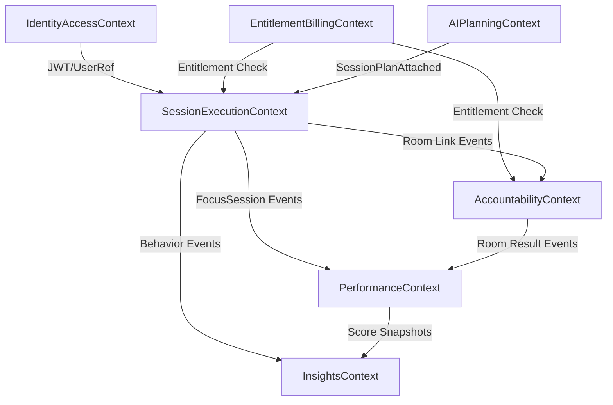
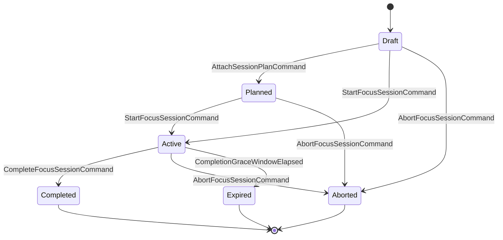
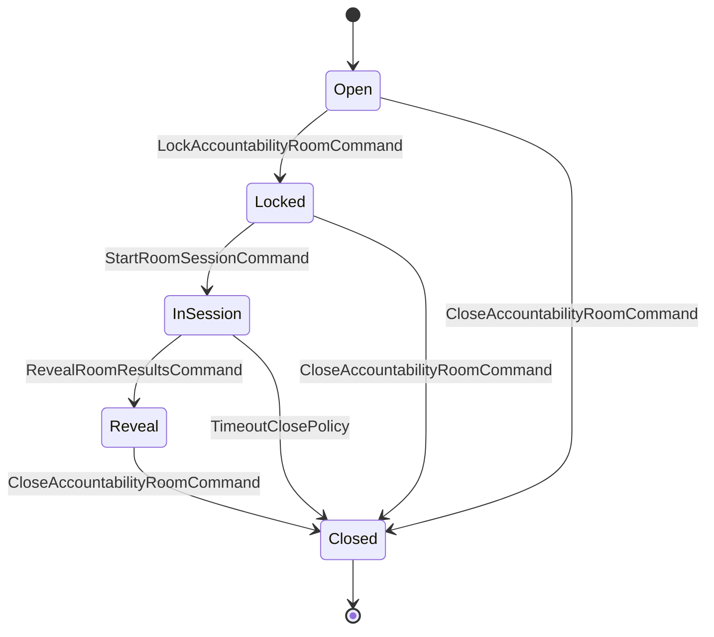
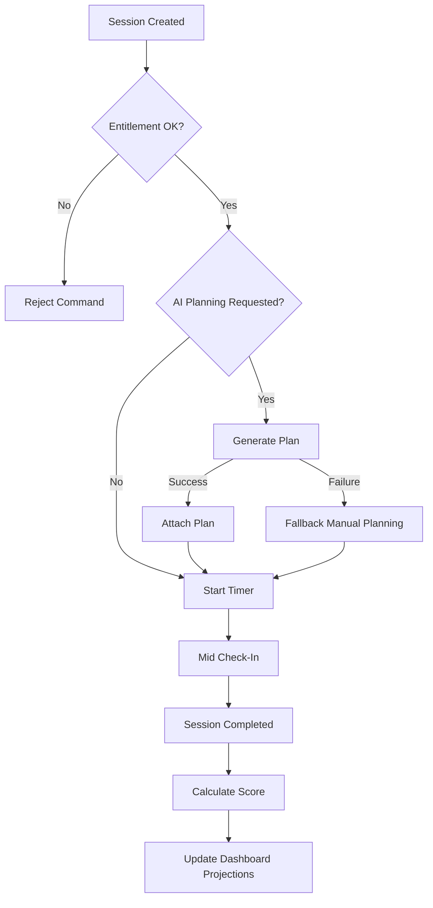
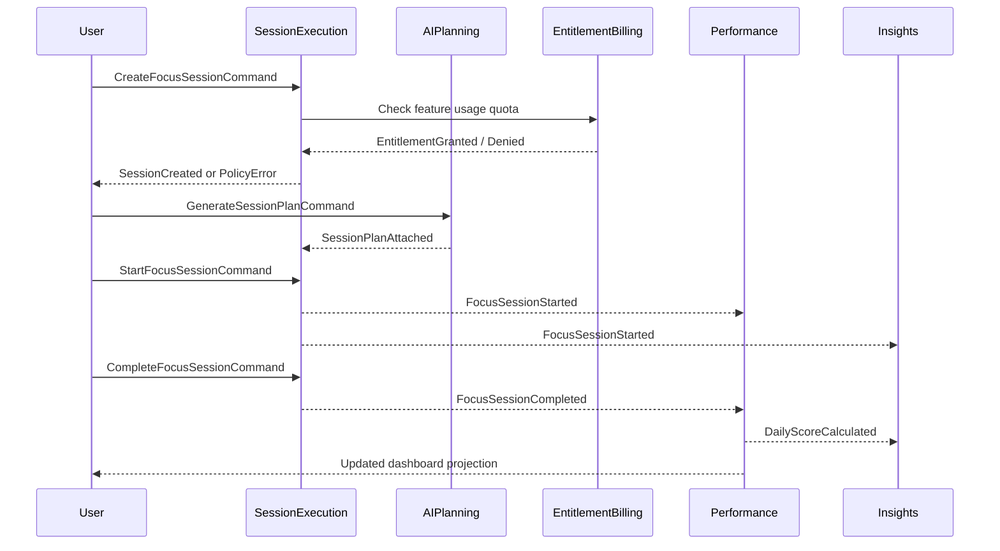

# FocusFlow Domain-Driven Design Specification

Project ID: `69a1dc8f937a4a78197bfa39`  
Task ID: `task-01KJQ328CNNBWFWC1DQ6835537`  
Source PRD: `/Users/ossiejam/agentflow-development-workspace/workspace/assembly-line/input/focus-flow.md`

## 1. Executive Summary

FocusFlow is a deep-work platform that combines timed focus sessions, optional AI planning, live accountability rooms, and performance scoring to increase measurable deep work output. The core domain is not timer mechanics alone; it is behavior change through structured commitments and social accountability.

Strategic drivers:
- Increase daily deep-work minutes per user.
- Improve retention through streaks, scoring, and room accountability.
- Convert free users to paid by gating high-value features (private rooms, advanced analytics, AI memory).

Primary constraints:
- MVP must run with free tier and public rooms first.
- Platform targets 10,000 concurrent sessions and 99.5% availability.
- Privacy policy forbids screen recording; focus evidence is inferred from interactions and optional browser-monitor signals.

Assumptions requiring domain expert review:
- A “session completion” means the timer reaches end and user submits a summary within a grace period.
- Focus Score is deterministic and auditable; no opaque ML scoring in MVP.
- Free-tier daily limit resets at tenant-local midnight.
- Private rooms are Pro-only and enforce entitlement at room creation time.
- A locked room blocks new joins but does not remove existing participants.

Success criteria for this design:
- Every aggregate and policy maps to a business objective or explicit PRD requirement.
- Bounded context boundaries are justified by consistency needs and team autonomy.
- Command/event model is implementation-ready with invariants, failure modes, and integration contracts.

## 2. Strategic Domain Analysis

### 2.1 Domain Narrative

FocusFlow solves a behavioral coordination problem: users overestimate focused time, struggle to structure work, and lack external accountability. The business value emerges when FocusFlow converts intent into commitments (session plan), guides execution (timer + check-ins), and closes the loop (score, streak, analytics, social reveal). The domain therefore prioritizes reliable state transitions, fair measurement, and anti-gaming safeguards over rich content management.

### 2.2 Subdomain Classification

| Subdomain | Classification | Why | Build/Buy/Outsource |
| --- | --- | --- | --- |
| Focus Session Orchestration | Core | Central product value; defines deep-work commitment lifecycle | Build |
| Accountability Collaboration | Core | Differentiating social mechanism for completion and retention | Build |
| Performance & Habit Intelligence | Core | Drives behavior reinforcement and product stickiness | Build |
| AI Session Planning | Supporting | Enhances outcomes, but can operate via external model providers | Build orchestration, outsource inference |
| Subscription & Entitlement | Supporting | Monetization critical but domain-common patterns exist | Build with Stripe integration |
| Analytics & Insights | Supporting | Needed for optimization and dashboards, not unique moat | Build |
| Identity & Access | Generic | Commodity authentication and session security | Buy/build hybrid (managed auth or standard stack) |
| Platform Observability & Audit | Generic | Operational necessity, not business differentiator | Build with standard tooling |

### 2.3 Subdomain Detail

#### Focus Session Orchestration (Core)

Description: Manages creation, planning attachment, timer execution, check-ins, interruption handling, completion, and summary.

Key business rules:
- Session duration must be between 15 and 180 minutes.
- Session cannot start without a goal.
- A session has one active timer window; no overlapping active session per user.
- Completion requires timer end plus summary submission within configured grace window.

Complexity drivers:
- Real-time timer synchronization across tabs/devices.
- Interruption signal quality vs false positives.
- Session recovery after disconnect.

Primary workflows:
- Create -> Plan -> Start -> MidCheck -> Complete -> Score.
- Interrupted -> Resume or Abort.

Events produced:
- `FocusSessionCreated`, `FocusSessionStarted`, `MidSessionCheckInRequested`, `FocusSessionInterrupted`, `FocusSessionCompleted`, `FocusSessionAborted`, `SessionSummarySubmitted`.

#### Accountability Collaboration (Core)

Description: Manages rooms, participant commitments, lock/start semantics, host moderation, chat, and reveal.

Key business rules:
- Room host controls lock/start and moderation actions.
- Once room is locked, no new participant can join.
- Result reveal occurs only after room session end.

Complexity drivers:
- Real-time participant state consistency.
- Host failover and disconnect handling.
- Abuse controls in chat and room entry.

Primary workflows:
- Create room -> Join -> Set goal -> Lock -> Start -> Reveal results.

Events produced:
- `RoomCreated`, `ParticipantJoinedRoom`, `RoomLocked`, `RoomSessionStarted`, `RoomSessionCompleted`, `ParticipantResultRevealed`, `RoomChatMessagePosted`.

#### Performance & Habit Intelligence (Core)

Description: Calculates daily score, weekly analytics features, streak continuity, and distraction rate.

Key business rules:
- Score updates are event-driven from completed sessions.
- Streak increments only when minimum daily completion threshold is met.
- Manual edits to score are forbidden; corrections are compensating events.

Complexity drivers:
- Late-arriving events and timezone boundaries.
- Anti-gaming rules (e.g., very short sessions excluded).

Primary workflows:
- Session completed -> score recalculation -> streak update -> dashboard refresh.

Events produced:
- `DailyScoreCalculated`, `StreakExtended`, `StreakBroken`, `WeeklyInsightSnapshotGenerated`.

#### AI Session Planning (Supporting)

Description: Generates task breakdown and time blocks from goal text; stores editable plans and learns from historical completions for Pro tier.

Key business rules:
- AI output must be user-editable before session start.
- Model prompts and outputs are versioned for traceability.
- Learning memory applies only to entitled users.

Complexity drivers:
- External model variability.
- Safety/quality constraints for generated tasks.
- Prompt/data governance.

Primary workflows:
- Submit goal -> generate plan -> user edits -> attach plan to session.

Events produced:
- `SessionPlanGenerated`, `SessionPlanEdited`, `SessionPlanAttached`, `PlanLearningMemoryUpdated`.

#### Subscription & Entitlement (Supporting)

Description: Manages free/pro plans, feature entitlements, usage caps, billing lifecycle, and Stripe synchronization.

Key business rules:
- Free users limited to 3 sessions/day.
- Private rooms require Pro entitlement.
- Entitlement checks are performed before command acceptance in dependent contexts.

Complexity drivers:
- Billing webhook idempotency.
- Trial/cancellation boundary conditions.
- Usage counter consistency at day rollover.

Primary workflows:
- Subscribe -> activate entitlement -> consume feature -> enforce limit.

Events produced:
- `SubscriptionActivated`, `SubscriptionRenewed`, `SubscriptionCanceled`, `EntitlementGranted`, `EntitlementRevoked`, `UsageLimitReached`.

#### Analytics & Insights (Supporting)

Description: Produces operational and product analytics for conversion, drop-off, and room participation.

Key business rules:
- Analytical events are immutable append-only.
- Privacy constraints prevent sensitive content capture.

Complexity drivers:
- Event schema evolution.
- Near-real-time vs batch reporting tradeoffs.

Primary workflows:
- Consume domain events -> materialize metrics -> expose dashboards.

Events produced:
- `AnalyticsEventIngested`, `KpiSnapshotPublished`.

#### Identity & Access (Generic)

Description: User lifecycle, authentication tokens, session security, password management.

Key business rules:
- JWT tokens must include tenant and user identifiers.
- Password hash never leaves identity boundary.

Complexity drivers:
- Session revocation and token rotation.

Events produced:
- `UserRegistered`, `UserAuthenticated`, `UserLoggedOut`, `UserTierChanged`.

#### Platform Observability & Audit (Generic)

Description: Audits business-critical actions and monitors service health/SLOs.

Key business rules:
- Billing and entitlement mutations are always audit logged.
- Correlation IDs required across request and event flows.

Complexity drivers:
- Multi-service trace stitching.
- Cost controls for high-cardinality telemetry.

Events produced:
- `AuditLogRecorded`, `SloThresholdBreached`.

## 3. Bounded Contexts

### 3.1 SessionExecutionContext

Overview:
- Purpose: Manage individual deep-work session lifecycle.
- Boundary rationale: Strong consistency required for timer state and session status transitions.
- Ownership: Focus Experience Team.
- Autonomy level: High; independent deployability with own data store schema.

Ubiquitous language:

| Term | Definition |
| --- | --- |
| FocusSession | A user-owned commitment to focused work with fixed duration and goal |
| SessionGoal | User-provided objective required before start |
| SessionTimer | Authoritative timing window from `started_at` and duration |
| SessionInterruption | Significant focus break detected during active session |
| SessionSummary | User-reported output captured at completion |

Domain services:
- `SessionPolicyService`
- Purpose: Validates cross-aggregate/session rules (no overlapping active sessions, duration policy).
- Operations: `validateSessionCreation`, `validateSessionStart`, `assessCompletionEligibility`.
- Example scenario: user starts a second active session; service rejects with policy violation.
- Idempotency: deterministic read-based validation; no side effects.

Repositories:
- `FocusSessionRepository`
- Aggregate served: `FocusSession`.
- Query methods: `findById`, `findActiveByUser`, `findByUserAndDateRange`, `save`.
- Persistence strategy: PostgreSQL with optimistic versioning.
- Consistency guarantees: transactional writes within aggregate boundary.

Use cases:
- Actor: End user.
- Flow: create session -> optionally attach plan -> start timer -> respond to check-in -> complete and submit summary.
- Error handling: rejects invalid duration, duplicate active session, stale command version.
- Cross-cutting concerns: entitlement check for daily limits and plan memory usage.

Read models:
- `TodaySessionStatusView` for dashboard “current session” card.
- `SessionHistoryView` for timeline and filters.

### 3.2 AccountabilityContext

Overview:
- Purpose: Coordinate group focus rooms and result reveal.
- Boundary rationale: Real-time membership and moderation rules differ from solo sessions.
- Ownership: Collaboration Team.
- Autonomy level: Medium-high; own write model, shared identity reference.

Ubiquitous language:

| Term | Definition |
| --- | --- |
| AccountabilityRoom | Live collaboration container led by host |
| RoomHost | User with moderation and lock/start authority |
| RoomParticipant | Member who declares a goal and submits result |
| RoomLock | State preventing new joins |
| ResultReveal | End-of-session disclosure of participant outcomes |

Domain services:
- `RoomModerationService`
- Purpose: enforce moderation and host action permissions.
- Operations: `canLockRoom`, `canRemoveParticipant`, `canRevealResults`.
- Example scenario: non-host attempts lock; service denies command.
- Idempotency: command-level dedup keys on `(roomId, commandId)`.

Repositories:
- `AccountabilityRoomRepository`
- Aggregate served: `AccountabilityRoom`.
- Query methods: `findById`, `findOpenPublicRooms`, `save`.
- Persistence strategy: PostgreSQL + Redis cache for active room roster.
- Consistency guarantees: write-side ACID; read-side eventual for participant lists.

Use cases:
- Actor: Host/Participant.
- Flow: host creates room -> participants join and set goals -> host locks and starts -> participants complete -> reveal.
- Error handling: room full/locked/not found, disconnected host, moderation conflicts.
- Cross-cutting concerns: entitlement for private room creation and abuse monitoring.

Read models:
- `RoomLobbyView`
- `RoomLivePresenceView`
- `RoomResultBoardView`

### 3.3 PerformanceContext

Overview:
- Purpose: Produce focus score, streak state, and performance summaries.
- Boundary rationale: scoring formulas evolve independently from session transaction logic.
- Ownership: Retention Intelligence Team.
- Autonomy level: High; event-driven, independently deployable.

Ubiquitous language:

| Term | Definition |
| --- | --- |
| DailyPerformanceRecord | Canonical per-user per-day scoring snapshot |
| FocusScore | Composite numeric indicator of focus quality |
| Streak | Consecutive qualified days meeting threshold |
| DistractionRate | Ratio of interruptions to active focus duration |
| CompletionRate | Completed sessions / started sessions over period |

Domain services:
- `FocusScoreCalculationService`
- Purpose: deterministic score computation from event stream.
- Operations: `calculateDailyScore`, `recalculateOnCorrection`, `computeStreakTransition`.
- Example scenario: late completion event updates prior day and re-links streak chain.
- Idempotency: event-id based exactly-once semantic at consumer boundary.

Repositories:
- `DailyPerformanceRecordRepository`
- Aggregates served: `DailyPerformanceRecord`, `StreakLedger`.
- Query methods: `findByUserAndDate`, `findLatestStreakByUser`, `save`.
- Persistence strategy: append+snapshot in PostgreSQL.
- Consistency guarantees: eventual consistency from source events, monotonic version per user-day.

Use cases:
- Actor: System (event consumer), End user (dashboard reader).
- Flow: consume `FocusSessionCompleted` -> recalc score -> publish score event -> update dashboard projection.
- Error handling: out-of-order events, replay after schema changes.
- Cross-cutting concerns: auditability of formula versions.

Read models:
- `PersonalDashboardView`
- `WeeklyAnalyticsView`
- `LeaderboardView` (optional feature flag)

### 3.4 AIPlanningContext

Overview:
- Purpose: Transform goal text into editable plan and maintain optional memory for Pro users.
- Boundary rationale: external AI integration and prompt/version governance are isolated.
- Ownership: AI Enablement Team.
- Autonomy level: Medium; depends on external provider SLA.

Ubiquitous language:

| Term | Definition |
| --- | --- |
| PlanRequest | Goal text and context submitted for planning |
| SessionPlan | Structured sequence of planned tasks/time blocks |
| PlanTemplateVersion | Prompt+format strategy revision identifier |
| PlanMemory | Historical preference profile for planning personalization |

Domain services:
- `PlanGenerationService`
- Purpose: orchestrate provider call and normalize output.
- Operations: `generatePlan`, `validatePlanStructure`, `applyUserEdits`.
- Example scenario: provider timeout triggers fallback template-based plan.
- Idempotency: request hash prevents duplicate plan generation within short window.

Repositories:
- `SessionPlanRepository`
- Aggregate served: `SessionPlanArtifact`.
- Query methods: `findLatestBySession`, `findMemoryByUser`, `save`.
- Persistence strategy: JSONB documents with version metadata.
- Consistency guarantees: strong consistency for write model; async propagation to SessionExecution.

Use cases:
- Actor: End user.
- Flow: submit goal -> generate -> edit -> attach to session.
- Error handling: provider failure, invalid structured output, entitlement denial for memory.
- Cross-cutting concerns: content safety and prompt audit trails.

Read models:
- `PlanPreviewView`
- `PlanVersionHistoryView`

### 3.5 EntitlementBillingContext

Overview:
- Purpose: enforce plan limits and synchronize subscription lifecycle.
- Boundary rationale: billing idempotency and financial reconciliation require isolated logic.
- Ownership: Monetization Team.
- Autonomy level: Medium-high; external payment processor integration.

Ubiquitous language:

| Term | Definition |
| --- | --- |
| SubscriptionAccount | User billing state and current plan |
| Entitlement | Named feature permission derived from plan |
| UsageCounter | Day-scoped consumption tracker for capped features |
| BillingCycle | Time interval for paid subscription |

Domain services:
- `EntitlementDecisionService`
- Purpose: answer “can execute command?” for feature-gated actions.
- Operations: `checkFeatureAccess`, `checkDailyUsage`, `grantUsage`.
- Example scenario: fourth session create attempt by free user denied.
- Idempotency: usage grants use unique command IDs to avoid double counting.

Repositories:
- `SubscriptionAccountRepository`
- `UsageCounterRepository`
- Query methods: `findByUser`, `findByUserAndDate`, `save`.
- Persistence strategy: PostgreSQL transactional updates.
- Consistency guarantees: strong consistency for writes; synchronous checks on command path.

Use cases:
- Actor: System via webhook, End user via upgrade flow.
- Flow: webhook updates subscription -> entitlement events emitted -> dependent contexts enforce.
- Error handling: duplicate webhooks, delayed payment confirmation.
- Cross-cutting concerns: PCI scope minimization through Stripe tokenization.

Read models:
- `PlanStatusView`
- `UsageMeterView`

### 3.6 IdentityAccessContext

Overview:
- Purpose: user identity lifecycle and JWT-based access control.
- Boundary rationale: credentials and auth policies must be isolated for security.
- Ownership: Platform Security Team.
- Autonomy level: High; reusable across products.

Ubiquitous language:

| Term | Definition |
| --- | --- |
| UserAccount | Identity principal with authentication credentials |
| AuthSession | Token issuance and revocation lifecycle |
| AccessToken | JWT used by clients to authorize requests |

Domain services:
- `AuthenticationService`
- `TokenService`

Repositories:
- `UserAccountRepository`
- `AuthSessionRepository`

Use cases:
- Register user, authenticate, rotate token, logout/revoke.

Read models:
- `CurrentUserProfileView`

### 3.7 InsightsContext

Overview:
- Purpose: analytical event ingestion and KPI publication.
- Boundary rationale: separates product analytics workload from transactional domains.
- Ownership: Data Platform Team.
- Autonomy level: High; append-only ingestion with independent storage.

Ubiquitous language:

| Term | Definition |
| --- | --- |
| AnalyticsFact | Immutable normalized event for BI queries |
| KpiSnapshot | Materialized KPI values at a point in time |
| FunnelStage | Named conversion step in product journey |

Domain services:
- `AnalyticsIngestionService`
- `KpiComputationService`

Repositories:
- `AnalyticsFactRepository`
- `KpiSnapshotRepository`

Use cases:
- Ingest events, compute funnel conversion, publish scheduled KPI snapshots.

Read models:
- `ConversionDashboardView`
- `DropoffAnalysisView`

## 4. Context Mapping

### 4.1 Relationship Table

| Upstream | Downstream | Pattern | Integration Mechanism | Rationale | Data Translation | Failure Handling | SLA/Coupling |
| --- | --- | --- | --- | --- | --- | --- | --- |
| IdentityAccess | SessionExecution | Customer/Supplier | Synchronous REST/JWT | Session actions require authenticated user | User IDs and tier claims normalized to `UserRef` | Reject unauthorized requests; token refresh | Tight request-time coupling |
| EntitlementBilling | SessionExecution | Published Language | Sync policy API + `EntitlementGranted/Revoked` events | Enforce daily limits and plan restrictions | `FeatureKey` mapping table | Fail-closed for protected actions | Medium coupling |
| AIPlanning | SessionExecution | Open Host Service | REST command + async `SessionPlanAttached` event | Session uses plan but does not own generation concerns | Plan JSON normalized into `TaskBlock` VO | Fallback to manual plan on AI failure | Loose coupling |
| SessionExecution | Performance | Domain Events | Event bus | Scoring derives from canonical session outcomes | Event versioned envelope | Consumer retries + dead-letter queue | Loose coupling |
| SessionExecution | Insights | Domain Events | Event stream ingestion | Product analytics from behavior events | ETL schema registry | At-least-once with dedup | Loose coupling |
| Accountability | Performance | Domain Events | Event bus | Room results influence completion confidence and social metrics | Participant outcome mapped to scoring modifiers | Missing room events treated as neutral | Loose coupling |
| EntitlementBilling | Accountability | Anti-Corruption Layer | Sync entitlement check | Private room eligibility enforcement | ACL maps billing plan to room permissions | Deny create/join when unavailable | Medium coupling |
| SessionExecution | Accountability | Conformist | Async event notifications | Link room session start to participant timers | Shared identifiers translated through `SessionRoomLink` | Compensating unlink on mismatch | Loose coupling |
| Performance | Insights | Published Language | Snapshot events + warehouse load | KPI publication for growth metrics | Score snapshot to KPI schema | Batch reprocess on errors | Loose coupling |

### 4.2 Context Map Diagram

### 4.3 Integration Principles

- Domain events are immutable and versioned (`eventType`, `eventVersion`, `eventId`, `occurredAt`, `correlationId`).
- Cross-context synchronous calls are limited to authorization/entitlement decisions that must fail fast.
- All async consumers are idempotent on `eventId`.
- Anti-corruption layers protect Core contexts from payment-provider and AI-provider model drift.

## 5. Aggregate Design

### 5.1 FocusSession Aggregate (SessionExecutionContext)

Business capability traceability:
- Capabilities: structured deep-work execution, completion tracking.
- PRD links: DW1-DW7, flow 7.1.

Identity strategy:
- `FocusSessionId` as ULID.
- External references: `UserId`, optional `RoomId`, optional `SessionPlanId`.

Lifecycle states:
- `Draft` -> `Planned` -> `Active` -> `Completed`.
- Alternate terminal states: `Aborted`, `Expired`.

Invariants:
- Duration in `[15, 180]` minutes.
- `SessionGoal` non-empty before `StartFocusSessionCommand`.
- At most one `Active` session per user.
- `CompleteFocusSessionCommand` accepted only when timer window elapsed and summary present.

Entities/value objects:
- Entities: `MidSessionCheckIn`.
- Value Objects: `SessionGoal`, `DurationMinutes`, `TaskBlock`, `InterruptionSignal`, `CompletionSummary`.

Commands:

| Command | Preconditions | Postconditions | Failure Modes |
| --- | --- | --- | --- |
| `CreateFocusSessionCommand` | Authenticated user, no invalid duration | Session in `Draft` with goal/duration | `InvalidDuration`, `DailyLimitExceeded`, `ActiveSessionExists` |
| `AttachSessionPlanCommand` | Session in `Draft` or `Planned`, plan format valid | Plan linked, state `Planned` | `SessionNotEditable`, `PlanValidationFailed` |
| `StartFocusSessionCommand` | Goal exists, no active session conflict | `startedAt` set, state `Active` | `PolicyViolation`, `ConcurrencyConflict` |
| `RecordMidSessionCheckInCommand` | Session `Active`, check-in window open | Check-in appended | `SessionNotActive`, `WindowClosed` |
| `RecordSessionInterruptionCommand` | Session `Active` | Interruption recorded, score-impact metadata emitted | `SessionNotActive` |
| `CompleteFocusSessionCommand` | Session `Active`, timer elapsed, summary provided | State `Completed`, `endedAt` set | `CompletionCriteriaNotMet`, `SummaryMissing` |
| `AbortFocusSessionCommand` | Session `Active` or `Draft` | State `Aborted` | `AlreadyTerminal` |

Events emitted:
- `FocusSessionCreated`
- `SessionPlanAttached`
- `FocusSessionStarted`
- `MidSessionCheckInRecorded`
- `FocusSessionInterrupted`
- `FocusSessionCompleted`
- `FocusSessionAborted`

Policies:
- `ActiveSessionUniquenessPolicy`
- `CompletionGraceWindowPolicy`
- `InterruptionEscalationPolicy`

Repository contract:
- `FocusSessionRepository.findById(FocusSessionId)`
- `FocusSessionRepository.findActiveByUser(UserId)`
- `FocusSessionRepository.save(FocusSession, expectedVersion)`

State machine:

### 5.2 AccountabilityRoom Aggregate (AccountabilityContext)

Business capability traceability:
- Capabilities: live focus rooms, social accountability.
- PRD links: AR1-AR7, flow 7.2.

Identity strategy:
- `AccountabilityRoomId` ULID.
- Child entity identity: `RoomParticipantId`.

Lifecycle states:
- `Open` -> `Locked` -> `InSession` -> `Reveal` -> `Closed`.

Invariants:
- Only host can execute lock/start/end/moderation commands.
- No joins when state is `Locked`, `InSession`, `Reveal`, or `Closed`.
- Each participant has at most one active commitment in the room.
- Reveal cannot start before room session ends.

Entities/value objects:
- Entities: `RoomParticipant`, `RoomChatMessage`.
- Value Objects: `RoomVisibility`, `ParticipantGoal`, `ResultSummary`, `ModerationAction`.

Commands:

| Command | Preconditions | Postconditions | Failure Modes |
| --- | --- | --- | --- |
| `CreateAccountabilityRoomCommand` | Host authenticated, entitlement valid for room visibility | Room `Open` | `EntitlementDenied`, `InvalidVisibility` |
| `JoinAccountabilityRoomCommand` | Room `Open`, not full, not banned | Participant added | `RoomLocked`, `RoomFull`, `ParticipantBlocked` |
| `SetParticipantGoalCommand` | Participant joined, room not `Closed` | Goal stored | `ParticipantNotFound`, `RoomClosed` |
| `LockAccountabilityRoomCommand` | Caller is host, room `Open` | State `Locked` | `NotHost`, `InvalidStateTransition` |
| `StartRoomSessionCommand` | Caller host, state `Locked`, minimum participants met | State `InSession` | `NotHost`, `ParticipantThresholdNotMet` |
| `SubmitParticipantResultCommand` | Participant joined, session ended | Result summary stored | `SessionNotFinished`, `ParticipantNotFound` |
| `RevealRoomResultsCommand` | Caller host, all mandatory windows closed | State `Reveal`, results published | `NotHost`, `RevealPreconditionsNotMet` |
| `CloseAccountabilityRoomCommand` | Host or timeout policy | State `Closed` | `InvalidStateTransition` |

Events emitted:
- `RoomCreated`
- `ParticipantJoinedRoom`
- `ParticipantGoalSet`
- `RoomLocked`
- `RoomSessionStarted`
- `ParticipantResultSubmitted`
- `RoomResultsRevealed`
- `RoomClosed`

Policies:
- `RoomLockPolicy`
- `HostAuthorityPolicy`
- `RevealCompletenessPolicy`

Repository contract:
- `AccountabilityRoomRepository.findById(AccountabilityRoomId)`
- `AccountabilityRoomRepository.findOpenPublicRooms(PageSpec)`
- `AccountabilityRoomRepository.save(AccountabilityRoom, expectedVersion)`

State machine:

### 5.3 DailyPerformanceRecord Aggregate (PerformanceContext)

Business capability traceability:
- Capabilities: scoring, streak tracking, retention reinforcement.
- PRD links: PS1-PS5, business objectives retention and engagement.

Identity strategy:
- Composite key `UserId + LocalDate`.

Lifecycle states:
- `Open` -> `Finalized` (with late correction reopening via compensating event).

Invariants:
- Score computed from approved formula version and immutable input events.
- Streak cannot increment by more than 1 day at a time.
- Negative deep work minutes forbidden.

Entities/value objects:
- Entities: `ScoreComponent`.
- Value Objects: `FocusScoreValue`, `StreakCount`, `DistractionRateValue`, `FormulaVersion`.

Commands:

| Command | Preconditions | Postconditions | Failure Modes |
| --- | --- | --- | --- |
| `AccumulateSessionOutcomeCommand` | Source event valid and deduped | Minutes/completion counters updated | `DuplicateEvent`, `InvalidSourceEvent` |
| `CalculateDailyScoreCommand` | Day window open or correction mode | Score recalculated, versioned | `FormulaUnavailable`, `InvalidInputSet` |
| `FinalizeDailyRecordCommand` | End-of-day cutoff reached | State `Finalized` | `DayNotClosed` |
| `ApplyScoreCorrectionCommand` | Correction reason and authority valid | Revised score, correction audit entry | `UnauthorizedCorrection`, `CorrectionConflict` |

Events emitted:
- `DailyScoreCalculated`
- `DailyRecordFinalized`
- `StreakExtended`
- `StreakBroken`
- `DailyScoreCorrected`

Policies:
- `StreakContinuityPolicy`
- `ScoreFormulaVersionPolicy`
- `LateEventCorrectionPolicy`

Repository contract:
- `DailyPerformanceRecordRepository.findByUserAndDate(UserId, LocalDate)`
- `DailyPerformanceRecordRepository.save(record, expectedVersion)`

### 5.4 SubscriptionAccount Aggregate (EntitlementBillingContext)

Business capability traceability:
- Capabilities: monetization, feature gating.
- PRD links: Subscription model free/pro features.

Identity strategy:
- `SubscriptionAccountId` (one per user/tenant).

Lifecycle states:
- `Free` -> `Trialing` -> `ActivePro` -> `PastDue` -> `Canceled`.

Invariants:
- Exactly one active plan per account at any moment.
- Entitlements derived only from current plan snapshot.
- Billing webhook events applied exactly once.

Commands:

| Command | Preconditions | Postconditions | Failure Modes |
| --- | --- | --- | --- |
| `ActivateProSubscriptionCommand` | Valid payment confirmation | State `ActivePro`, entitlements granted | `PaymentUnconfirmed`, `DuplicateActivation` |
| `CancelSubscriptionCommand` | Account not already canceled | State `Canceled` at period end | `InvalidStateTransition` |
| `RecordBillingWebhookCommand` | Signature verified, event not seen | Billing state transitioned | `InvalidWebhookSignature`, `DuplicateWebhookEvent` |
| `ConsumeUsageQuotaCommand` | Feature quota exists and remaining > 0 | Counter decremented | `QuotaExceeded`, `FeatureNotCapped` |

Events emitted:
- `SubscriptionActivated`
- `SubscriptionRenewed`
- `SubscriptionPastDue`
- `SubscriptionCanceled`
- `EntitlementGranted`
- `EntitlementRevoked`
- `UsageLimitReached`

Policies:
- `FreeTierDailyLimitPolicy`
- `PrivateRoomEntitlementPolicy`
- `AdvancedAnalyticsEntitlementPolicy`

Repository contract:
- `SubscriptionAccountRepository.findByUser(UserId)`
- `UsageCounterRepository.findByUserAndFeatureAndDate(UserId, FeatureKey, LocalDate)`
- transactional `save`.

### 5.5 SessionPlanArtifact Aggregate (AIPlanningContext)

Business capability traceability:
- Capabilities: AI-assisted session planning.
- PRD links: AI1-AI5.

Identity strategy:
- `SessionPlanId` ULID linked to `FocusSessionId`.

Lifecycle states:
- `Requested` -> `Generated` -> `Edited` -> `Attached`.

Invariants:
- Plan must contain at least one `TaskBlock` with positive time estimate.
- Total planned duration cannot exceed session duration + tolerance.
- Only latest plan version can be attached.

Commands:

| Command | Preconditions | Postconditions | Failure Modes |
| --- | --- | --- | --- |
| `GenerateSessionPlanCommand` | Goal present, provider reachable or fallback available | Plan generated with template version | `ProviderUnavailable`, `InvalidGoalInput` |
| `EditSessionPlanCommand` | Plan exists and editable state | New plan revision persisted | `InvalidTaskBlock`, `RevisionConflict` |
| `AttachGeneratedPlanToSessionCommand` | Session and plan compatible | State `Attached`, integration event emitted | `SessionDurationMismatch`, `PlanNotCurrent` |
| `UpdatePlanLearningMemoryCommand` | User Pro entitlement, feedback available | Memory profile updated | `EntitlementDenied`, `InsufficientFeedbackData` |

Events emitted:
- `SessionPlanGenerated`
- `SessionPlanEdited`
- `SessionPlanAttached`
- `PlanLearningMemoryUpdated`

Policies:
- `PlanSchemaValidationPolicy`
- `ProMemoryEligibilityPolicy`

Repository contract:
- `SessionPlanRepository.findById(SessionPlanId)`
- `SessionPlanRepository.findLatestBySession(FocusSessionId)`
- `PlanMemoryRepository.findByUser(UserId)`

### 5.6 UserAccount Aggregate (IdentityAccessContext)

Business capability traceability:
- Capabilities: secure user access.
- PRD links: Auth service and JWT requirement.

Identity strategy:
- `UserId` ULID.

Lifecycle states:
- `Registered` -> `Verified` -> `Active` -> `Suspended`.

Invariants:
- Unique email per tenant.
- Password hashes stored with approved algorithm parameters.

Commands/events:
- Commands: `RegisterUserCommand`, `AuthenticateUserCommand`, `RotateTokenCommand`, `SuspendUserCommand`.
- Events: `UserRegistered`, `UserAuthenticated`, `AccessTokenIssued`, `UserSuspended`.

## 6. Domain Events

### 6.1 Event Catalogue

| Event Name | Source Context | Payload (Key Fields) | Consumers | Ordering Guarantees |
| --- | --- | --- | --- | --- |
| `FocusSessionCreated` | SessionExecution | `sessionId`, `userId`, `goal`, `duration`, `createdAt` | Insights, Performance (funnel) | Ordered per `sessionId` |
| `SessionPlanAttached` | SessionExecution/AIPlanning | `sessionId`, `planId`, `taskCount`, `attachedAt` | Insights | Ordered per `sessionId` |
| `FocusSessionStarted` | SessionExecution | `sessionId`, `userId`, `startedAt`, `duration` | Performance, Accountability, Insights | Ordered per `sessionId` |
| `MidSessionCheckInRecorded` | SessionExecution | `sessionId`, `checkInId`, `status`, `timestamp` | Insights | Ordered per `sessionId` |
| `FocusSessionInterrupted` | SessionExecution | `sessionId`, `interruptionType`, `detectedAt` | Performance, Insights | Ordered per `sessionId` |
| `FocusSessionCompleted` | SessionExecution | `sessionId`, `userId`, `endedAt`, `deepWorkMinutes`, `summaryId` | Performance, Insights, Accountability | Ordered per `sessionId` |
| `FocusSessionAborted` | SessionExecution | `sessionId`, `userId`, `reason`, `abortedAt` | Performance, Insights | Ordered per `sessionId` |
| `RoomCreated` | Accountability | `roomId`, `hostId`, `visibility`, `createdAt` | Insights | Ordered per `roomId` |
| `ParticipantJoinedRoom` | Accountability | `roomId`, `participantId`, `joinedAt` | Insights | Ordered per `roomId` |
| `RoomLocked` | Accountability | `roomId`, `lockedBy`, `lockedAt` | Insights | Ordered per `roomId` |
| `RoomSessionStarted` | Accountability | `roomId`, `startedAt`, `participantCount` | SessionExecution, Insights | Ordered per `roomId` |
| `ParticipantResultSubmitted` | Accountability | `roomId`, `participantId`, `resultSummary`, `submittedAt` | Performance, Insights | Ordered per `roomId` |
| `RoomResultsRevealed` | Accountability | `roomId`, `revealedAt`, `resultCount` | Insights | Ordered per `roomId` |
| `DailyScoreCalculated` | Performance | `userId`, `date`, `focusScore`, `deepWorkMinutes`, `formulaVersion` | Insights, Dashboard projection | Ordered per `userId+date` |
| `StreakExtended` | Performance | `userId`, `newStreakCount`, `date` | Insights, Notification | Ordered per `userId` |
| `StreakBroken` | Performance | `userId`, `previousStreakCount`, `date` | Insights, Notification | Ordered per `userId` |
| `SubscriptionActivated` | EntitlementBilling | `userId`, `plan`, `cycleStart`, `cycleEnd` | SessionExecution, Accountability, AIPlanning, Insights | Ordered per `userId` |
| `EntitlementGranted` | EntitlementBilling | `userId`, `featureKey`, `grantedAt` | SessionExecution, Accountability, AIPlanning | Ordered per `userId+featureKey` |
| `EntitlementRevoked` | EntitlementBilling | `userId`, `featureKey`, `revokedAt` | SessionExecution, Accountability, AIPlanning | Ordered per `userId+featureKey` |
| `UsageLimitReached` | EntitlementBilling | `userId`, `featureKey`, `date`, `limit` | SessionExecution UI, Insights | Ordered per `userId+featureKey+date` |
| `SessionPlanGenerated` | AIPlanning | `planId`, `sessionId`, `templateVersion`, `generatedAt` | SessionExecution, Insights | Ordered per `planId` |
| `PlanLearningMemoryUpdated` | AIPlanning | `userId`, `memoryVersion`, `updatedAt` | Insights | Ordered per `userId` |

### 6.2 Event Standards

- Delivery semantics: at-least-once with consumer idempotency.
- Envelope fields: `eventId`, `eventType`, `eventVersion`, `occurredAt`, `producer`, `correlationId`, `causationId`, `tenantId`.
- Retention: 13 months for analytics events, 24 months for billing/entitlement audit-relevant events.
- Schema evolution: backward compatible additive fields only within major version.

## 7. Integration Architecture

### 7.1 Synchronous Interfaces

| API | Caller -> Callee | Purpose | Timeout | Failure Strategy |
| --- | --- | --- | --- | --- |
| `POST /sessions` | Client -> SessionExecution | Create session | 2s | Return policy error codes, no retry on validation errors |
| `POST /sessions/{id}/start` | Client -> SessionExecution | Start timer | 2s | Retry once on transient DB conflicts |
| `POST /rooms` | Client -> Accountability | Create room | 2s | Entitlement check preflight |
| `POST /entitlements/check` | Session/Room/AI -> EntitlementBilling | Feature authorization | 300ms | Fail-closed for protected features |
| `POST /ai/plans/generate` | Client -> AIPlanning | Generate structured plan | 8s | Fallback template plan if provider timeout |
| Stripe Webhook Endpoint | Stripe -> EntitlementBilling | Billing state sync | 5s | Verify signature, idempotent replay |

### 7.2 Asynchronous Channels

- Event bus topics:
- `focus.sessions.v1`
- `focus.rooms.v1`
- `focus.performance.v1`
- `focus.entitlements.v1`
- `focus.ai.v1`
- `focus.analytics.v1`

Message contract guarantees:
- Partition keys: `sessionId`, `roomId`, or `userId` depending on stream.
- Ordering: guaranteed only within partition.
- Retry policy: exponential backoff with max attempts and dead-letter queue.
- Poison message handling: DLQ + replay tool with schema validation.

### 7.3 Process Managers / Sagas

#### DeepWorkSessionSaga

- Trigger: `CreateFocusSessionCommand` accepted.
- Steps:
- Validate entitlement (daily quota).
- Optionally request AI plan generation.
- Start timer and schedule mid-check.
- On completion, emit scoring trigger and analytics event.
- Compensation:
- If AI fails, continue with manual plan mode.
- If session start fails after plan attached, keep session in `Planned` state.
- Timeout/escalation:
- If no start within 24h of creation, auto-expire draft.
- State tracking:
- `Created`, `PlannedOptional`, `Started`, `Completed`, `Expired`, `Failed`.

#### RoomFocusRevealSaga

- Trigger: `RoomSessionStarted`.
- Steps:
- Link participant session refs.
- Await participant results or timeout.
- Trigger reveal when end condition satisfied.
- Publish room summary metrics.
- Compensation:
- If host disconnects, transfer host role or enforce timeout close.
- Timeout/escalation:
- Auto-close room after configured inactivity threshold.
- State tracking:
- `Active`, `AwaitingResults`, `RevealReady`, `Closed`.

#### SubscriptionTransitionSaga

- Trigger: Stripe webhook (`invoice.paid`, `invoice.payment_failed`, `customer.subscription.deleted`).
- Steps:
- Validate webhook signature.
- Transition `SubscriptionAccount`.
- Publish entitlement grant/revoke events.
- Trigger downstream cache invalidation.
- Compensation:
- On duplicate webhook, ignore via idempotency key.
- On partial downstream failure, retry event publication.
- Timeout/escalation:
- If entitlement propagation exceeds 2 minutes, emit ops alert.
- State tracking:
- `Received`, `Validated`, `Applied`, `Published`, `Reconciled`.

Process flow diagram:

### 7.4 Cross-Cutting Concerns

Authentication and authorization:
- JWT-based auth with short-lived access tokens and refresh flow.
- Role checks for room host actions.

Multi-tenancy:
- Tenant-aware IDs in event envelope and write models.
- Free-tier limits computed per tenant-user.

Audit and compliance:
- Immutable audit log for entitlement, billing, moderation, and correction actions.
- No screen recording by policy.

Observability:
- SLOs: 99.5% availability; p95 command latency targets per endpoint.
- Distributed tracing with `correlationId` propagated across sync and async calls.

Error handling strategy:
- Domain errors return explicit business codes.
- Retries only for transient infrastructure errors.
- DLQ and replay for async processing.

## 8. Read Model Projections

| Projection | Source Events | Storage | Refresh | Consumers | Notes |
| --- | --- | --- | --- | --- | --- |
| `DashboardTodayProjection` | `FocusSessionStarted`, `FocusSessionCompleted`, `DailyScoreCalculated`, `StreakExtended/Broken` | Redis + Postgres cache table | Near real-time (<5s) | Web dashboard | Primary home screen model |
| `SessionHistoryProjection` | Session lifecycle events | Postgres read schema | Event-driven | User history page | Filter by date/status |
| `RoomLobbyProjection` | `RoomCreated`, `ParticipantJoinedRoom`, `RoomLocked`, `RoomClosed` | Redis | Real-time | Room list page | High churn, eventual consistency acceptable |
| `RoomResultProjection` | `ParticipantResultSubmitted`, `RoomResultsRevealed` | Postgres | Event-driven | End-of-session reveal | Hides results before reveal flag |
| `UsageMeterProjection` | `SubscriptionActivated`, `EntitlementGranted/Revoked`, `UsageLimitReached`, usage-consume events | Postgres | Event-driven | Billing/settings UI | Must align with command-side checks |
| `WeeklyAnalyticsProjection` | Session and score events | Warehouse + materialized views | Hourly batch + incremental | Analytics pages | Supports PS2 metrics |
| `ConversionFunnelProjection` | Registration/session/upgrade events | Warehouse | Daily | Growth team dashboard | Tracks free-to-paid conversion |

Projection quality standards:
- Every projection includes replayable builders.
- Projection lag monitored; alert if lag > 60s for operational projections.
- Projection schema changes versioned with backfill plan.

## 9. Implementation Recommendations

### 9.1 Delivery Roadmap

Phase 1: Core (MVP)
- Implement `IdentityAccessContext`, `SessionExecutionContext`, baseline `PerformanceContext`.
- Implement public `AccountabilityContext` rooms without private visibility.
- Implement free-tier quota (`3 sessions/day`) in `EntitlementBillingContext` with no paid billing yet.
- Deliver projections: dashboard today, session history, room lobby.

Phase 2: Supporting
- Add `AIPlanningContext` generation/edit/attach flow.
- Integrate Stripe and full `SubscriptionAccount` lifecycle.
- Add private rooms, advanced analytics entitlement checks.
- Expand performance with streak policy tuning and weekly analytics projection.

Phase 3: Integration and Scale
- Optimize WebSocket scaling and room presence partitioning.
- Introduce leaderboards and optional external integrations (Slack/Teams).
- Harden replay tooling, data retention policies, and operational dashboards.

### 9.2 Technical Recommendations

- Use modular monolith with explicit context modules first; promote to services only when scaling pressure justifies split.
- Use outbox pattern for reliable event publication from transactional contexts.
- Use optimistic concurrency (`expectedVersion`) on aggregate saves.
- Adopt explicit command handlers and domain event classes (PascalCase naming).
- Keep scoring formulas in versioned config with migration strategy.

### 9.3 Traceability Matrix

| Business Capability / Objective | Aggregate / Service / Policy | Section Reference |
| --- | --- | --- |
| Structured deep-work sessions | `FocusSession`, `SessionPolicyService`, `ActiveSessionUniquenessPolicy` | 5.1 |
| Social accountability | `AccountabilityRoom`, `RoomModerationService`, `RevealCompletenessPolicy` | 5.2 |
| Retention and engagement | `DailyPerformanceRecord`, `FocusScoreCalculationService`, `StreakContinuityPolicy` | 5.3 |
| Monetization and conversion | `SubscriptionAccount`, `EntitlementDecisionService`, `FreeTierDailyLimitPolicy` | 5.4 |
| AI-assisted planning | `SessionPlanArtifact`, `PlanGenerationService`, `PlanSchemaValidationPolicy` | 5.5 |
| Secure access | `UserAccount`, `AuthenticationService` | 5.6 |

### 9.4 Risk Register

| Risk | Impact | Mitigation |
| --- | --- | --- |
| Score perceived as unfair | Retention drop | Publish formula transparency and correction events |
| AI output quality variance | Planning abandonment | Editable plans, fallback templates, provider guardrails |
| Real-time room instability | Accountability feature trust erosion | Redis-backed presence, heartbeat detection, host failover |
| Entitlement drift across services | Incorrect feature access | Centralized check API + entitlement events + cache TTL |
| Event schema drift | Consumer failures | Schema registry and compatibility checks in CI |

### 9.5 Testing and Quality Gates

- Aggregate tests:
- command/invariant/event tests for each aggregate.
- Contract tests:
- event schema compatibility and API error contracts.
- Saga tests:
- happy path + compensation paths + timeout paths.
- Non-functional tests:
- concurrent session load (target 10,000), WebSocket scale, chaos testing for broker outages.

## 10. Appendices

### Appendix A: Assumptions and Open Questions

Assumptions:
- Session completion requires timer end + summary within 10-minute grace window.
- Mid-session check-in cadence defaults to one prompt at session midpoint.
- Free-tier quota applies to created sessions, not only completed sessions.
- Room capacity defaults to 50 participants in MVP.
- Leaderboard is feature-flagged and off by default.

Open questions for domain experts:
1. Should aborted sessions count toward daily free-tier quota?
2. Can host start room session without all participants setting goals?
3. What is the minimum criterion for streak continuity (minutes, count, or both)?
4. Should AI memory be user-resettable and exportable for privacy compliance?
5. How are disputed focus scores corrected and who has authority?

### Appendix B: ADRs

#### ADR-001: Event-Driven Scoring

- Context: Scoring depends on session outcomes and may evolve independently from session runtime.
- Decision: Implement `PerformanceContext` as event-driven consumer of session events.
- Alternatives considered:
- Synchronous score updates in session transaction.
- Nightly batch-only scoring.
- Consequences:
- Positive: decoupled evolution, replay support, lower write latency in session flow.
- Negative: eventual consistency and need for lag monitoring.

#### ADR-002: Outbox Pattern for Domain Event Reliability

- Context: Session completion and billing events must not be lost between DB commit and broker publish.
- Decision: Use transactional outbox in all write-heavy contexts.
- Alternatives considered:
- Direct broker publish in command transaction.
- Best-effort async publish without persistence.
- Consequences:
- Positive: reliable at-least-once event publication.
- Negative: extra infrastructure and replay tooling complexity.

#### ADR-003: Entitlement Checks Fail-Closed

- Context: Paid/private features must not be exposed on entitlement service degradation.
- Decision: Dependent contexts fail-closed for protected actions when entitlement decision unavailable.
- Alternatives considered:
- Fail-open with post-hoc reconciliation.
- Local stale cache only with long TTL.
- Consequences:
- Positive: revenue protection and policy integrity.
- Negative: temporary feature denial during incidents.

#### ADR-004: AI Provider Isolation via Anti-Corruption Layer

- Context: Model/provider changes can break plan shape and downstream assumptions.
- Decision: Keep provider-specific prompt/response mapping inside AIPlanning ACL.
- Alternatives considered:
- Direct provider SDK usage in session context.
- Single shared utility library without context ownership.
- Consequences:
- Positive: protects core domain from provider drift.
- Negative: extra translation code and monitoring.

### Appendix C: Global Ubiquitous Language Glossary

| Term | Context | Definition |
| --- | --- | --- |
| FocusSession | SessionExecution | User commitment to a timed deep-work effort |
| SessionGoal | SessionExecution | Mandatory objective statement for a session |
| SessionPlan | AIPlanning / SessionExecution | Structured task breakdown attached to a session |
| TaskBlock | AIPlanning / SessionExecution | Planned unit of work with estimated minutes |
| MidSessionCheckIn | SessionExecution | In-session prompt capturing user focus state |
| SessionInterruption | SessionExecution | Event signaling focus disruption during active session |
| AccountabilityRoom | Accountability | Shared focus room with host-led controls |
| RoomHost | Accountability | Participant with lock/start/moderation authority |
| ResultReveal | Accountability | Controlled publication of participant outcomes |
| FocusScore | Performance | Composite score of daily focus quality |
| DailyPerformanceRecord | Performance | Canonical daily scoring snapshot per user |
| Streak | Performance | Consecutive number of qualifying focus days |
| SubscriptionAccount | EntitlementBilling | Billing and plan state for a user |
| Entitlement | EntitlementBilling | Feature-level access permission |
| UsageCounter | EntitlementBilling | Time-scoped usage tally against quotas |
| UserAccount | IdentityAccess | Auth principal with credentials and status |
| AnalyticsFact | Insights | Immutable event record used for BI metrics |
| KpiSnapshot | Insights | Materialized metric value at a defined timestamp |

### Appendix D: Additional Mermaid Diagram (Aggregate Interaction)

